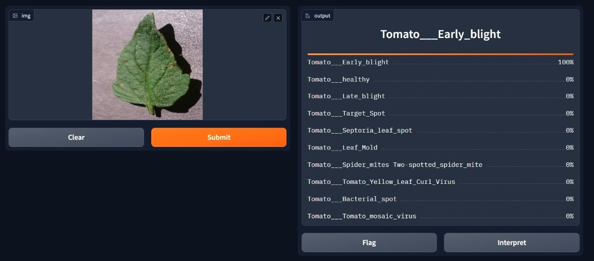

# Crop Health Management – Tomato Leaf Disease Detection

Classifies tomato leaf images into 10 disease/healthy classes using a CNN, with a Gradio web interface for instant predictions.



## Features
- CNN built with TensorFlow/Keras
- 10-class classification (9 diseases + healthy)
- Upload a leaf image and get per-class confidence scores
- Gradio web UI

## Classes
- Bacterial spot
- Early blight
- Late blight
- Leaf mold
- Septoria leaf spot
- Spider mites (two-spotted)
- Target spot
- Tomato yellow leaf curl virus
- Tomato mosaic virus
- Healthy

## Dataset
[PlantVillage Tomato Leaf Dataset (Kaggle)](https://www.kaggle.com/datasets/charuchaudhry/plantvillage-tomato-leaf-dataset): 14,529 images, 80/20 train/validation split.

## Model
| Layer | Details |
|---|---|
| Rescaling | 1/255 |
| Conv2D + MaxPool | 16 filters, 3×3 |
| Conv2D + MaxPool | 32 filters, 3×3 |
| Conv2D + MaxPool | 64 filters, 3×3 |
| Flatten | |
| Dense | 128, ReLU |
| Dense | 10, Softmax |

- Input: 180×180×3
- Optimizer: Adam
- Batch size: 32, Epochs: 10

## Results
- Training accuracy: ~98%
- Validation accuracy: ~92%

## Project Structure
├── model_final.ipynb # full notebook: data loading, training, Gradio app
├── maincode.ipynb # same code as a plain script
├── dataset link # Kaggle dataset URL
└── README.md


## Installation
```bash
git clone https://github.com/Bipra09/Crop-Health-Management.git
cd Crop-Health-Management
pip install tensorflow "gradio<4" matplotlib numpy pillow
```

## Usage
1. Download the dataset and extract it so each class has its own folder.
2. In `model_final.ipynb`, set `local_data_dir` to your dataset path.
3. Run all cells. Training starts, then the Gradio app launches.
4. Open the local URL shown, upload a leaf image, and click **Submit**.

## Tech Stack
Python, TensorFlow/Keras, Gradio, NumPy, Matplotlib, Pillow

## Future Improvements
- Data augmentation and dropout to reduce overfitting
- Transfer learning (MobileNet, ResNet)
- Save and load the trained model instead of retraining
- IoT camera integration for daily automated monitoring
- Treatment recommendations per disease

## License
Licensed under the MIT License. See [LICENSE](LICENSE).
